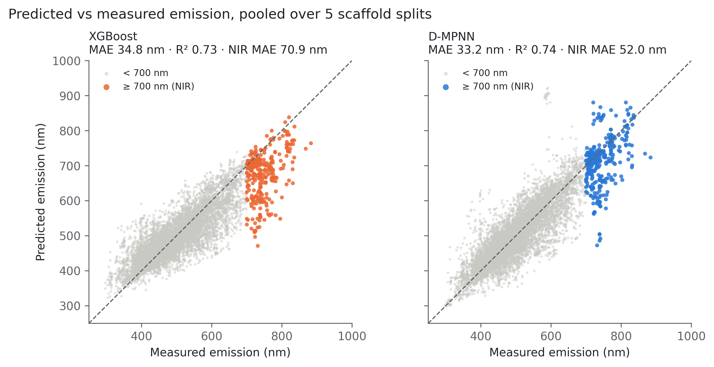
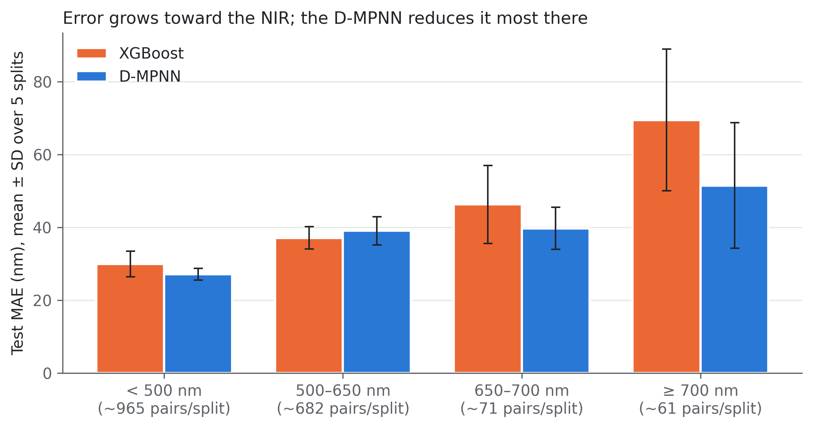
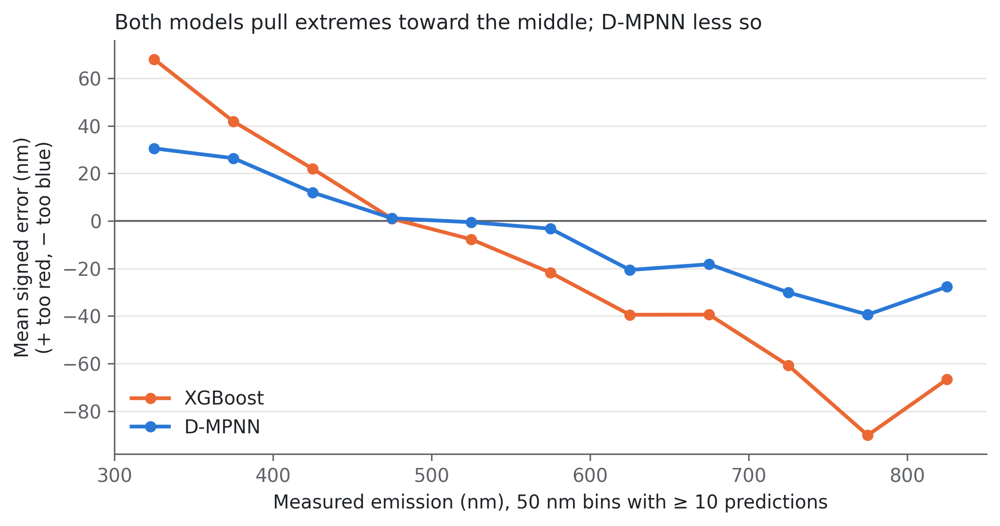
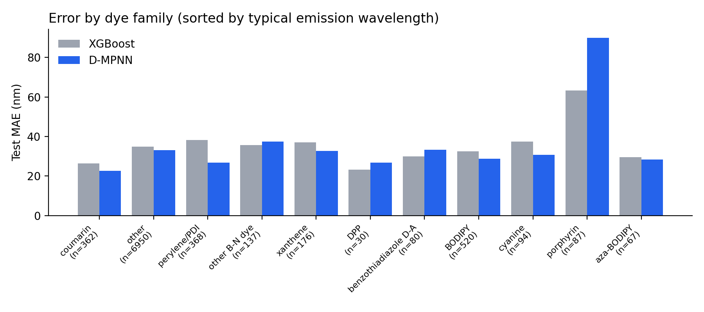
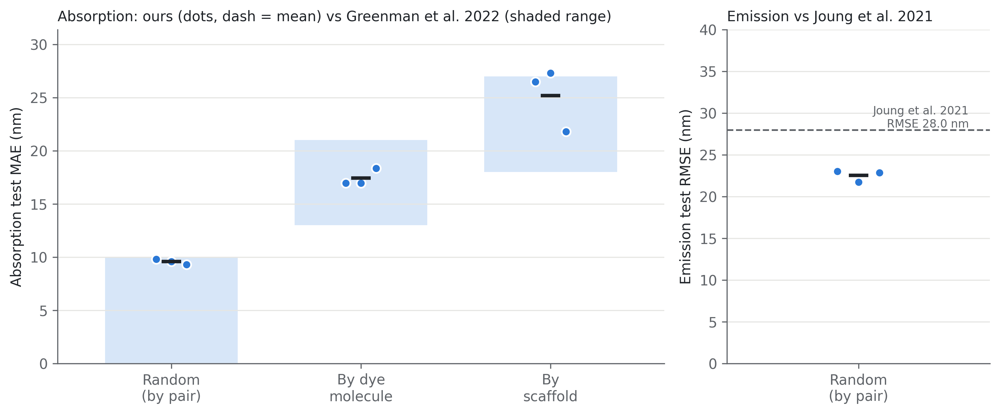

# Machine-Learning Accelerated Design of Near-Infrared Organic Emitters

Predicting the emission wavelength of organic fluorophores with graph neural networks, with a focus on the hard and under-represented **near-infrared (NIR, ≥ 700 nm)** region, as groundwork for screening new NIR emitters.

**Author:** Sruthi Akella · MSc Chemistry + B.Tech Chemical Engineering, BITS Pilani, Hyderabad Campus
**Status:** model development and evaluation complete · virtual screening in progress

---

## Highlights

- Curated **17,850 chromophore–solvent pairs** (6,412 chromophores, 1,021 solvents) from a public experimental optical database.
- Compared a fingerprint **XGBoost** baseline with a two-input **directed message-passing neural network (D-MPNN, Chemprop)** under rigorous **scaffold splits** (5 random seeds, paired statistics).
- Showed that overall metrics hide poor NIR performance: only 3.4% of the data is NIR, and both models predict NIR emitters systematically too blue (**regression to the mean**).
- The D-MPNN lowers NIR error from **69.5 to 51.5 nm** (MAE) and beats XGBoost on NIR emitters **in 5/5 splits** (paired t-test p ≈ 0.04).
- Tested three improvement strategies (fine-tuning, multitask learning, ensembling). Found and quantified **catastrophic forgetting** in fine-tuning, fixed it with a two-stage scheme, and showed that **ensembling** is the only change that improves accuracy in every split.
- **Validated the pipeline against published benchmarks:** absorption MAEs of 9.6 / 17.4 / 25.2 nm for random / molecule / scaffold splits fall within the ranges reported by Greenman et al. (2022) on the same database.
- Model-flagged NIR candidates are truly NIR **~66–75% of the time vs. a 3.4% base rate (~20× enrichment)** on unseen molecule families.

<p align="center">
  
</p>

---

## Dataset

Experimental optical properties of organic compounds from **Joung et al., *Scientific Data* (2020)**: 20,236 measurements covering 6,815 chromophores (SMILES), solvents, absorption and emission maxima, quantum yields and lifetimes.

**Curation** (`notebooks/01_data_cleaning.ipynb`):
1. Keep entries with a measured emission maximum; drop the gas-phase entry.
2. Canonicalize chromophore and solvent SMILES with RDKit.
3. Average repeated measurements of the same chromophore–solvent pair.
4. Assign **Bemis–Murcko scaffolds** and split 80/10/10 so that whole scaffold families stay in one set, so the test set contains only unseen molecule families.

About 6% of entries are solid-state (neat or doped film) measurements. They were kept and flagged; errors on them were comparable to or lower than on solution data.

> The raw database is not redistributed here. Download it from the original publication and place it in `data/raw/`.

---

## Methods

| Component | Details |
|---|---|
| **Features (XGBoost)** | Morgan count fingerprint (r = 2, 1024 bits) + 217 RDKit 2D descriptors + 5 conjugation features for the chromophore; Morgan fingerprint + 6 descriptors for the solvent |
| **D-MPNN** | Chemprop v2, separate message-passing encoders for chromophore and solvent (depth 4, hidden size 300), 2-layer feed-forward head, target = emission energy (eV) |
| **Evaluation** | 5 scaffold splits (seeds 42, 0, 1, 2, 3); MAE, RMSE, R², bias, % within ±20/±50 nm; per-wavelength-bin errors; NIR precision/recall; paired t-tests across splits |
| **Error analysis** | Substructure-based dye-family tagging (BODIPY, aza-BODIPY, cyanine, porphyrin, xanthene, D–A, …), TADF / MR-TADF flags, solution vs. film |
| **Improvements tested** | Fine-tuning on red/NIR data, two-stage general→specialist prediction, emission + absorption multitask learning, ensembling |
| **Compute** | Google Colab and Kaggle (single T4 GPU) |

---

## Results

### Emission prediction (5 scaffold splits, mean ± SD)

| Model | MAE (nm) | RMSE (nm) | R² | Within ±50 nm | NIR MAE (nm) | NIR F1 |
|---|---|---|---|---|---|---|
| XGBoost | 34.8 ± 4.1 | 47.2 ± 5.5 | 0.73 | 77% | 69.5 ± 19.5 | 55% |
| D-MPNN | 33.2 ± 3.0 | 46.5 ± 6.1 | 0.74 | 78% | 51.5 ± 17.2 | 65% |
| D-MPNN, two-stage | 33.6 ± 3.2 | 47.1 ± 6.2 | 0.73 | 77% | 46.4 ± 12.3 | 68% |
| D-MPNN, multitask (emission + absorption) | 32.8 ± 2.0 | 45.5 ± 3.2 | 0.75 | 79% | 48.7 ± 14.0 | 68% |
| **Ensemble (D-MPNN + multitask)** | **31.6 ± 2.5** | **44.3 ± 4.3** | **0.76** | **80%** | 47.4 ± 14.9 | 67% |

The multitask model also predicts **absorption** maxima: MAE 25.8 ± 2.6 nm, R² 0.84.

<p align="center">
  
  
</p>

### Key findings

- **Evaluation matters.** The same XGBoost model gives R² 0.94 on a random split but 0.73–0.75 on scaffold splits. Random splits overstate how well a model handles new chemistry.
- **The NIR tail is the hard part.** Errors roughly double above 700 nm, and predictions are biased toward the blue.
- **Graph networks help most at the extremes.** The D-MPNN's advantage over fingerprints is concentrated in the NIR and blue regions, and spread across many dye families.
- **Fine-tuning alone backfires.** Training further on red/NIR data improves red predictions but shifts all blue predictions ~100 nm too red (catastrophic forgetting). A two-stage scheme removes the damage, but its NIR gains are not statistically significant.
- **Hardest families:** modified porphyrinoids (bacteriochlorins, core-modified porphyrins), where small changes inside the macrocycle cause large colour shifts that neither model captures.
- **Remaining error is mainly data-limited:** few NIR molecule families in the training data.

<p align="center">
  
</p>

### Pipeline validation against the literature

| Benchmark | This work | Published |
|---|---|---|
| Absorption MAE, random split | 9.6 ± 0.2 nm | < 10 nm (Greenman et al., 2022) |
| Absorption MAE, molecule split | 17.4 ± 0.8 nm | 13–21 nm |
| Absorption MAE, scaffold split | 25.2 ± 3.0 nm | 18–27 nm |
| Emission RMSE, random split | 22.5 ± 0.7 nm | 28.0 nm (Joung et al., 2021; larger dataset incl. films) |

<p align="center">
  
</p>

---

## Repository structure

```
├── notebooks/
│   ├── 01_data_cleaning.ipynb          # curation + scaffold split
│   ├── 02_featurization_xgboost.ipynb  # fingerprints/descriptors + XGBoost baseline
│   ├── 03_dmpnn.ipynb                  # first Chemprop D-MPNN
│   ├── 04_multiseed.ipynb              # XGBoost vs D-MPNN over 5 scaffold splits
│   ├── 05_error_analysis.ipynb         # dye families, TADF/MR-TADF, solution vs film
│   ├── 06_figures.ipynb                # main comparison figures
│   ├── 07_finetune.ipynb               # fine-tuning + two-stage (Kaggle)
│   ├── 08_multitask.ipynb              # emission + absorption (Kaggle)
│   ├── 09_ft_mt_figures.ipynb          # figures for the improvement experiments
│   └── 10_reproduction.ipynb           # benchmark against published results (Kaggle)
├── results/
│   ├── figures/                        # all figures (300 dpi)
│   └── tables/                         # predictions, metrics and trained models, one folder per experiment
├── data/
│   └── README.md                       # how to obtain the raw database
├── requirements.txt
└── README.md
```

---

## How to run

1. Download the database from Joung et al. (2020) into `data/raw/`.
2. Install dependencies: `pip install -r requirements.txt` (or run the notebooks on Google Colab / Kaggle, where only `rdkit` and `chemprop` need installing).
3. Run the notebooks in order. Notebooks 01, 02, 05, 06 and 09 run on CPU; 03, 04, 07, 08 and 10 need a GPU for reasonable run times.
4. Splits and model initialization are seeded, so results are reproducible.

---

## Limitations and future work

- Predicts emission **wavelength**, not brightness (quantum yield); NIR emitters are often weakly emissive.
- NIR training data is scarce (~350 molecules ≥ 700 nm), so predictions for unfamiliar NIR scaffolds are extrapolations.
- Future directions: adding quantum-chemistry features (e.g. TD-DFT or xTB excitation energies), curating more NIR data, measured solvent-polarity descriptors, and uncertainty-aware virtual screening of designed NIR candidates (in progress).

---

## References

- Joung, J. F. *et al.* Experimental database of optical properties of organic compounds. *Scientific Data* **7**, 295 (2020).
- Joung, J. F. *et al.* Deep learning optical spectroscopy based on experimental database: potential applications to molecular design. *JACS Au* **1**, 427–438 (2021).
- Greenman, K. P., Green, W. H. & Gómez-Bombarelli, R. Multi-fidelity prediction of molecular optical peaks with deep learning. *Chemical Science* **13**, 1152–1162 (2022).
- Heid, E. *et al.* Chemprop: a machine learning package for chemical property prediction. *J. Chem. Inf. Model.* **64**, 9–17 (2024).

## License

Code released under the MIT License. The dataset belongs to its original authors; see their publication for terms of use.
